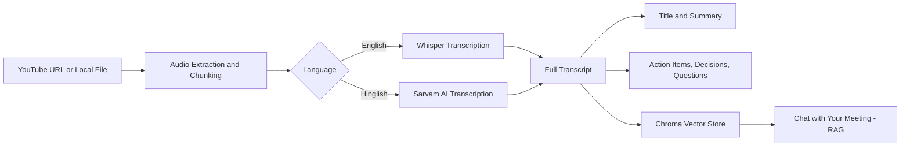

# AI Video Assistant
 
Turn any video or meeting recording into a searchable transcript, an AI-generated summary, and a chatbot you can ask questions to.
 
Give it a YouTube link or a local audio/video file. It transcribes the audio, generates a title, summary, action items, key decisions, and open questions — then lets you chat with the transcript afterward.
 
## Features
 
- 🎥 **Flexible input** — YouTube URL or local audio/video file
- 🌐 **Bilingual transcription** — [OpenAI Whisper](https://github.com/openai/whisper) for English, [Sarvam AI](https://www.sarvam.ai/) for Hindi-English (Hinglish)
- ✂️ **Handles long recordings** — audio is chunked automatically and summarized map-reduce style, so length isn't limited by model context
- 📝 **Structured output** — auto-generated title, summary, action items (with owner & deadline), key decisions, and open questions
- 💬 **Chat with your meeting** — a RAG pipeline (Chroma + HuggingFace embeddings + Mistral) lets you ask follow-up questions about anything discussed
## How it works
 

 
## Project structure
 
```
AI-Video-Assistant/
├── main.py                   # CLI entry point — runs the pipeline, then a chat loop
├── app.py                    # Streamlit UI — process a video and chat with it in the browser
├── requirements.txt
├── .streamlit/
│   └── config.toml           # UI theme
├── core/
│   ├── transcriber.py        # Whisper + Sarvam AI transcription
│   ├── Summarize.py          # Title generation + map-reduce summarization
│   ├── extractor.py          # Action items / decisions / open questions
│   ├── vector_store.py       # Chroma vector store + embeddings
│   └── rag_engine.py         # RAG chain for chatting with the transcript
└── utlis/
    └── audio_processor.py    # YouTube download, audio conversion, chunking
```
 
## Prerequisites
 
- Python 3.12 (the pinned dependencies are verified on 3.12; newer versions may not have compatible wheels)
- [ffmpeg](https://ffmpeg.org/download.html) installed and on your `PATH` (required by `pydub` and `yt-dlp`)
- A [Mistral AI](https://console.mistral.ai/) API key — used for summarization, extraction, and chat
- A [Sarvam AI](https://www.sarvam.ai/) API key — only needed for Hinglish transcription
## Installation
 
```bash
git clone https://github.com/AyushNeedsCaffeine/AI-Video-Assistant.git
cd AI-Video-Assistant
python -m venv venv
source venv/bin/activate        # Windows: venv\Scripts\activate
pip install -r requirements.txt
```
 
## Configuration
 
Copy `.env.example` to `.env` and fill in your keys:
 
```bash
cp .env.example .env
```
 
| Variable | Required | Default | Description |
|---|---|---|---|
| `MISTRAL_API_KEY` | Yes | — | Summaries, extraction, and RAG chat |
| `MISTRAL_MODEL` | No | `ministral-8b-latest` | Mistral chat model — must be available to your API key's tier |
| `SARVAM_API_KEY` | Only for Hinglish | — | Hinglish transcription |
| `WHISPER_MODEL` | No | `small` | Any [Whisper model size](https://github.com/openai/whisper#available-models-and-languages) (`tiny`/`base`/`small`/`medium`/`large`) |
| `SARVAM_STT_MODEL` | No | `saaras:v2.5` | Sarvam speech-to-text model |
 
## Usage
 
```bash
python main.py
```
 
You'll be prompted for:
1. A YouTube URL or a path to a local audio/video file
2. A language — `english` or `hinglish`
Once processing finishes, you'll see the title, summary, action items, key decisions, and open questions — then you can chat with the transcript directly in the terminal (type `exit` to quit).

### Streamlit UI

For a browser UI instead of the CLI:

```bash
streamlit run app.py
```

Enter a YouTube URL or upload a local file in the sidebar, pick a language, and click **Process video**. Once it finishes you'll get tabs for the summary, action items, key decisions, open questions, and full transcript, a chat box for follow-up questions, and download buttons for the transcript and a combined meeting-minutes file. Theme lives in `.streamlit/config.toml`.

### Running from WSL

If the project lives on a Windows drive but you're in a WSL shell, the existing `.venv` is a Windows virtualenv. Use its interpreter directly (WSL interop):

```bash
./.venv/Scripts/python.exe -m streamlit run app.py   # UI
./.venv/Scripts/python.exe main.py                   # CLI
```

Alternatively, create a native Linux virtualenv with Python 3.12 and install the requirements there.

## Tech stack
 
- **Transcription:** [OpenAI Whisper](https://github.com/openai/whisper), [Sarvam AI](https://www.sarvam.ai/)
- **LLM orchestration:** [LangChain](https://www.langchain.com/), [Mistral AI](https://mistral.ai/)
- **Vector search:** [Chroma](https://www.trychroma.com/), HuggingFace `sentence-transformers` (`all-MiniLM-L6-v2`)
- **Audio/video handling:** `yt-dlp`, `pydub`, `ffmpeg`
- **UI:** [Streamlit](https://streamlit.io/)
## Documentation

- [Software Requirements Specification](docs/SRS.md) — v1 baseline, v2 interface plan, and future scope for the Google Meet bot and LangSmith evaluation.

## Version roadmap

- **v1.0.0** — current Streamlit app and CLI, runtime/config fixes, yt-dlp update, SRS
- **v2.0.0** — new FastAPI + Jinja2 + HTMX interface with improved UX; pipeline behavior unchanged
- **Future** — Google Meet bot (live capture) and LangSmith-based evaluation/regression testing

## Roadmap / known issues

- [x] `requirements.txt` was missing `langchain-chroma` — added, and all versions are now pinned against a verified-working install (see the comment at the top of the file for CPU-only PyTorch install instructions)
- [x] The RAG chat step's bug is fixed — `load_rag_chain()` was calling `get_retriver()` with no arguments
- [x] `app.py` (Streamlit UI) is now built — see [Streamlit UI](#streamlit-ui) above
- [x] Fixed a Whisper transcription bug — `load_model()` only returned the cached model on the *first* call; any English recording producing more than one chunk (i.e. longer than 10 minutes) would crash on the second chunk
- [x] Fixed the vector store reusing one fixed collection name across every run, which let chat context bleed between unrelated videos — each processed video now gets its own isolated collection
- [x] Switched `HuggingFaceEmbeddings` to the maintained `langchain_huggingface` package (the `langchain_community` import path is being sunset)
- [x] Renamed `env.example` → `.env.example` so `cp .env.example .env` in Configuration actually works
- [x] Made the YouTube download step's filename handling robust to any source container (previously only handled `.webm`/`.m4a` by name)
- [x] Made the Mistral model configurable via `MISTRAL_MODEL` — `mistral-small-latest` is not available on every API key tier and caused HTTP 429s
- [x] Fixed `.env` load ordering so `SARVAM_API_KEY`, `WHISPER_MODEL`, and `SARVAM_STT_MODEL` are read after `load_dotenv()`
- [x] Updated `yt-dlp` to 2026.10.26 — older versions failed YouTube downloads with `HTTP Error 403: Forbidden`
## License
 
No license file is included yet. Until one is added, all rights are reserved by default — add a `LICENSE` file (e.g. MIT, Apache-2.0) if you'd like others to use or contribute to this project.


## 🤝 Connect

<div align="center">

[](https://github.com/AyushNeedsCaffeine)
[](https://www.linkedin.com/in/ayush-jain357/)

</div>

<div align="center">

⭐ **Star this repo if you find it helpful — it keeps me motivated to keep pushing!**

