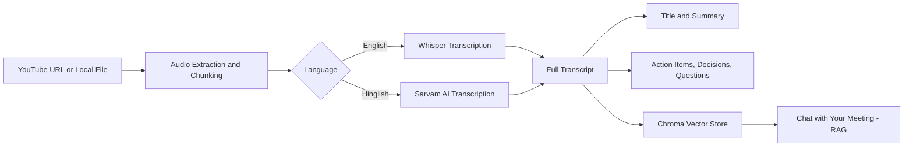

# Lens

**Watch Less. Understand More.**

Turn any video or meeting recording into a searchable transcript, an AI-generated summary, and a chatbot you can ask questions to.
 
Give it a YouTube link or a local audio/video file. It transcribes the audio, generates a title, summary, action items, key decisions, and open questions — then lets you chat with the transcript afterward.
 
## Features
 
- 🖥️ **Web app** — FastAPI + Jinja2 UI with background jobs, live stage progress, animated processing, tabbed results, HTMX chat, and downloadable minutes
- 🎥 **Flexible input** — YouTube URL or local audio/video file
- 🌐 **Bilingual transcription** — [OpenAI Whisper](https://github.com/openai/whisper) for English, [Sarvam AI](https://www.sarvam.ai/) for Hindi-English (Hinglish)
- ✂️ **Handles long recordings** — audio is chunked automatically and summarized map-reduce style, so length isn't limited by model context
- 📝 **Structured output** — auto-generated title, summary, action items (with owner & deadline), key decisions, and open questions
- 💬 **Chat with your meeting** — a RAG pipeline (Chroma + HuggingFace embeddings + Mistral) lets you ask follow-up questions about anything discussed

## How it works
 

 
## Project structure
 
```
Lens/
├── app/                      # FastAPI web UI (v2)
│   ├── main.py               # Routes, templates, downloads, SSE, HTMX chat
│   ├── config.py             # Project paths
│   ├── services/
│   │   ├── jobs.py           # In-memory job store
│   │   └── pipeline.py       # Background pipeline runner
│   ├── templates/            # Jinja2 pages and HTMX partials
│   └── static/               # CSS, JS, and logo marks
├── main.py                   # CLI entry point — runs the pipeline, then a chat loop
├── app.py                    # Legacy Streamlit UI (v1)
├── assets/                   # Lens branding assets
├── docs/SRS.md               # Software requirements and future roadmap
├── requirements.txt
├── .streamlit/
│   └── config.toml           # Legacy Streamlit theme
├── core/
│   ├── transcriber.py        # Whisper + Sarvam AI transcription
│   ├── Summarize.py          # Title generation + map-reduce summarization
│   ├── extractor.py          # Action items / decisions / open questions
│   ├── vector_store.py       # Chroma vector store + embeddings
│   └── rag_engine.py         # RAG chain for chatting with the transcript
└── utlis/
    └── audio_processor.py    # YouTube download, audio conversion, chunking
```
 
## Prerequisites
 
- Python 3.12 (the pinned dependencies are verified on 3.12; newer versions may not have compatible wheels)
- [ffmpeg](https://ffmpeg.org/download.html) installed and on your `PATH` (required by `pydub` and `yt-dlp`)
- A [Mistral AI](https://console.mistral.ai/) API key — used for summarization, extraction, and chat
- A [Sarvam AI](https://www.sarvam.ai/) API key — only needed for Hinglish transcription

## Installation
 
```bash
git clone https://github.com/AyushNeedsCaffeine/AI-Video-Assistant.git
cd AI-Video-Assistant
python -m venv venv
source venv/bin/activate        # Windows: venv\Scripts\activate
pip install -r requirements.txt
```
 
## Configuration
 
Copy `.env.example` to `.env` and fill in your keys:
 
```bash
cp .env.example .env
```
 
| Variable | Required | Default | Description |
|---|---|---|---|
| `MISTRAL_API_KEY` | Yes | — | Summaries, extraction, and RAG chat |
| `MISTRAL_MODEL` | No | `ministral-8b-latest` | Mistral chat model — must be available to your API key's tier |
| `SARVAM_API_KEY` | Only for Hinglish | — | Hinglish transcription |
| `WHISPER_MODEL` | No | `small` | Any [Whisper model size](https://github.com/openai/whisper#available-models-and-languages) (`tiny`/`base`/`small`/`medium`/`large`) |
| `SARVAM_STT_MODEL` | No | `saaras:v2.5` | Sarvam speech-to-text model |
 
## Usage

### Web app (v2)

```bash
python -m uvicorn app.main:app --host 0.0.0.0 --port 8501
```

Open http://localhost:8501 and choose a YouTube link or upload an audio/video file. Pick **English (Whisper)** or **Hinglish / Indic (Sarvam)**, then start the job.

The job page shows live stage progress over SSE while the pipeline runs in the background, with an animated lens/fox loader. When it completes you get tabs for **Summary**, **Action items**, **Key decisions**, **Open questions**, **Transcript**, and **Downloads**, with the RAG chat panel below. Chat updates in place via HTMX and falls back to a normal form post if JavaScript is unavailable. Press **Enter** to send a question or **Shift + Enter** for a new line.

The web UI uses a navy/orange/brown palette, GSAP entrance and hover motion, and respects `prefers-reduced-motion`. Clicking the Lens logo asks for confirmation and returns to the landing page without restarting the server.

Jobs are held in memory for v2.0, so restarting the server clears them. Durable job storage is planned for v2.1. The UI loads Tailwind CSS, Alpine.js, HTMX, and GSAP from CDNs.

### CLI

```bash
python main.py
```

You'll be prompted for:
1. A YouTube URL or a path to a local audio/video file
2. A language — `english` or `hinglish`
Once processing finishes, you'll see the title, summary, action items, key decisions, and open questions — then you can chat with the transcript directly in the terminal (type `exit` to quit).

### Legacy Streamlit UI (v1)

The original Streamlit interface remains available until feature parity is reached:

```bash
streamlit run app.py --server.port 8502
```

Enter a YouTube URL or upload a local file, pick a language, and click **Process video**. Theme lives in `.streamlit/config.toml`.

### Running from WSL

If the project lives on a Windows drive but you're in a WSL shell, the existing `.venv` is a Windows virtualenv. Use its interpreter directly (WSL interop):

```bash
./.venv/Scripts/python.exe -m uvicorn app.main:app --host 0.0.0.0 --port 8501   # Web UI
./.venv/Scripts/python.exe main.py                                             # CLI
./.venv/Scripts/python.exe -m streamlit run app.py --server.port 8502          # Legacy UI
```

Alternatively, create a native Linux virtualenv with Python 3.12 and install the requirements there.

## Tech stack
 
- **Transcription:** [OpenAI Whisper](https://github.com/openai/whisper), [Sarvam AI](https://www.sarvam.ai/)
- **LLM orchestration:** [LangChain](https://www.langchain.com/), [Mistral AI](https://mistral.ai/)
- **Vector search:** [Chroma](https://www.trychroma.com/), HuggingFace `sentence-transformers` (`all-MiniLM-L6-v2`)
- **Audio/video handling:** `yt-dlp`, `pydub`, `ffmpeg`
- **Web UI (v2):** [FastAPI](https://fastapi.tiangolo.com/) + [Uvicorn](https://www.uvicorn.org/), Jinja2, [HTMX](https://htmx.org/), [Alpine.js](https://alpinejs.dev/), [Tailwind CSS](https://tailwindcss.com/), [GSAP](https://gsap.com/)
- **Legacy UI (v1):** [Streamlit](https://streamlit.io/)

## Documentation

- [Software Requirements Specification](docs/SRS.md) — v1 baseline, v2 interface plan, and future scope for the Google Meet bot and LangSmith evaluation.

## Version roadmap

- **v1.0.x** — Streamlit app and CLI, runtime/config fixes, yt-dlp update, SRS, Lens rebrand
- **v2.0.0** — FastAPI + Jinja2 + HTMX web UI: background jobs, SSE progress, chat, downloads, logo soft reset
- **v2.0.1** — tabbed results and downloads tab, navy/orange/brown refresh, animated loader, Enter-to-send, GSAP motion
- **v2.1** — durable job storage, cancellation, automated tests, Docker
- **Future** — Google Meet bot (live capture) and LangSmith-based evaluation/regression testing

## Roadmap / known issues

- [x] `requirements.txt` was missing `langchain-chroma` — added, and all versions are now pinned against a verified-working install (see the comment at the top of the file for CPU-only PyTorch install instructions)
- [x] The RAG chat step's bug is fixed — `load_rag_chain()` was calling `get_retriver()` with no arguments
- [x] `app.py` (Streamlit UI) is now built — see [Legacy Streamlit UI](#legacy-streamlit-ui-v1) above
- [x] Fixed a Whisper transcription bug — `load_model()` only returned the cached model on the *first* call; any English recording producing more than one chunk (i.e. longer than 10 minutes) would crash on the second chunk
- [x] Fixed the vector store reusing one fixed collection name across every run, which let chat context bleed between unrelated videos — each processed video now gets its own isolated collection
- [x] Switched `HuggingFaceEmbeddings` to the maintained `langchain_huggingface` package (the `langchain_community` import path is being sunset)
- [x] Renamed `env.example` → `.env.example` so `cp .env.example .env` in Configuration actually works
- [x] Made the YouTube download step's filename handling robust to any source container (previously only handled `.webm`/`.m4a` by name)
- [x] Made the Mistral model configurable via `MISTRAL_MODEL` — `mistral-small-latest` is not available on every API key tier and caused HTTP 429s
- [x] Fixed `.env` load ordering so `SARVAM_API_KEY`, `WHISPER_MODEL`, and `SARVAM_STT_MODEL` are read after `load_dotenv()`
- [x] Updated `yt-dlp` to 2026.10.26 — older versions failed YouTube downloads with `HTTP Error 403: Forbidden`
- [x] Added the v2 FastAPI web UI with background jobs, SSE stage progress, HTMX chat with form fallback, artifact downloads, and logo-click soft reset
- [x] Added the new Lens logo and unified the orange/navy theme across both UIs
- [x] Polished the v2 results UI: tabbed results/downloads, animated processing loader, Enter-to-send, warm navy/orange/brown theme, and reduced-motion-aware GSAP animations
- [ ] v2.1: persist jobs in SQLite, add cancellation, automated tests, and Docker

## License
 
No license file is included yet. Until one is added, all rights are reserved by default — add a `LICENSE` file (e.g. MIT, Apache-2.0) if you'd like others to use or contribute to this project.


## 🤝 Connect

<div align="center">

[](https://github.com/AyushNeedsCaffeine)
[](https://www.linkedin.com/in/ayush-jain357/)

</div>

<div align="center">

⭐ **Star this repo if you find it helpful — it keeps me motivated to keep pushing!**

